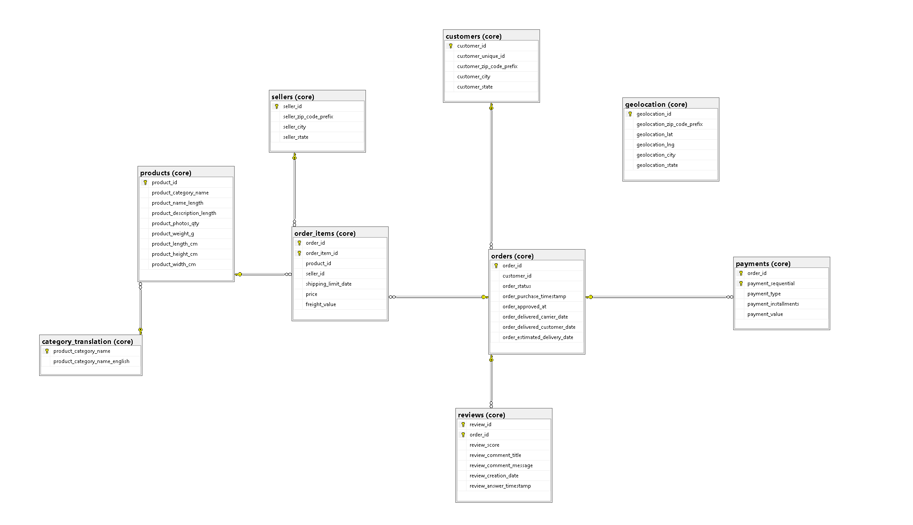

# Olist E-commerce Database (SQL Server)

A personal SQL project: loading the public Olist e-commerce dataset into SQL Server, cleaning its types and checking that nothing was lost or changed on the way. Everything is written by hand in T-SQL, as numbered scripts that can be run from scratch.

## Data

The Olist e-commerce public dataset (Brazilian marketplace orders), available on Kaggle. It is a set of 9 CSV files:

|File|Content|
|-|-|
|`olist_orders_dataset.csv`|orders and their dates|
|`olist_order_items_dataset.csv`|items in each order (product, seller, price, freight)|
|`olist_customers_dataset.csv`|customers|
|`olist_order_payments_dataset.csv`|payments|
|`olist_order_reviews_dataset.csv`|customer reviews|
|`olist_products_dataset.csv`|products|
|`olist_sellers_dataset.csv`|sellers|
|`product_category_name_translation.csv`|category names, Portuguese to English|
|`olist_geolocation_dataset.csv`|zip code coordinates|

The CSV files are not included in this repository.

## Architecture



```
CSV files  ->  staging (dbo.stg_*)  ->  core (core.*)
                all NVARCHAR            correct data types,
                no keys                 primary & foreign keys
```

* **Staging** tables are raw copies of the CSV files. Every column is `NVARCHAR`, so the import never fails on dirty data. Column names are kept exactly as in the source, including its typos (`product_name_lenght`).
* **Core** tables have proper data types (`INT`, `DECIMAL`, `DATE`, `DATETIME2`, `CHAR`), primary keys, and foreign keys. Data is moved from staging with `TRY_CAST`. The typos in column names are fixed here (`product_name_length`).

## Scripts

Run them in this order:

|Script|What it does|
|-|-|
|`01_create_database.sql`|drops and creates the `OlistECommerce` database|
|`02_create_tables.sql`|creates the staging tables|
|`03_bulk_import.sql`|loads the CSV files into staging with `BULK INSERT`|
|`04_create_core_tables.sql`|creates the `core` schema and tables with types and primary keys|
|`05_load_core.sql`|loads staging into core|
|`06_validate_core_tables.sql`|validation queries (read only)|
|`07_clean_core_tables.sql`|corrections of source data problems in core (run after 05, can be repeated)|
|`08_add_foreign_keys.sql`|adds foreign key constraints across `core` tables (repeatable with `IF NOT EXISTS`)|

## How to run

1. Download the CSV files to a local folder.
2. In `03_bulk_import.sql` set `@data_path` to that folder.
3. Run the scripts 01 to 05, then 07 and 08, in order.
4. Use the queries from `06` to check the results, one at a time (select and press F5). Running the whole file returns dozens of result sets, including heavy queries on `geolocation` (over 1 million rows).
5. After `07`, run the related checks from `06` again to confirm the fixes.

Note: `01_create_database.sql` deletes an existing `OlistECommerce` database together with its data. `05_load_core.sql` deletes existing rows from core tables (child tables first) before loading, so it can be repeated safely.

## Validation

`TRY_CAST` does not raise an error when it cannot convert a value, it silently returns `NULL`. That is why every core table is checked after loading (file `06`):

* row count, core vs staging,
* `NULL` and empty strings in columns converted with `TRY_CAST`, core vs staging,
* value ranges (negative values, fake dates like `1900-01-01`),
* length of `CHAR` columns (zip codes and states), so nothing is padded with spaces,
* table specific checks (payment types, city names, coordinates, review dates),
* cross-table checks: rows that point to a record that does not exist (orphaned rows), which would block foreign keys.

## Findings in the source data

Problems that come from the dataset itself. They are documented in the validation file (`06`) and handled in the cleaning step (`07`).

* **orders:** 160 orders have no approval date, and some have no delivery dates (not approved or not delivered yet). These `NULL` values are valid.
* **products:** 610 products have no category, name length, description length and photos count, and 2 have no weight and dimensions. 4 products have weight 0.
* **products and categories:** 13 products belong to 2 categories that have no translation (`pc_gamer`, `portateis_cozinha_e_preparadores_de_alimentos`). Fixed in `07`: the two missing translations were added by hand (the English names are my own, not from the dataset).
* **payments:** 3 payments have type `not_defined` with value 0.00. Zeros also appear in `payment_installments`.
* **order_items:** `shipping_limit_date` goes up to 2020. `freight_value = 0` is valid (free shipping).
* **sellers:** 2 values in `seller_city` contained invalid data (digits `'04482255'` and an email address). Fixed in `07`: replaced with correct city names (`maringa` and `rio de janeiro`) resolved via `seller_zip_code_prefix` matching against `core.geolocation`.
* **geolocation:** 31 points in 23 towns have coordinates outside Brazil. City names are inconsistent (with and without accents, f.e. `santana do paraiso` and `santana do paraíso`).
* **reviews:** `review_id` is not unique, so the primary key is `(review_id, order_id)`.

## Design decisions

* Composite primary keys where a single column is not unique: `order_items (order_id, order_item_id)`, `payments (order_id, payment_sequential)`, `reviews (review_id, order_id)`.
* `geolocation` has a surrogate key (`IDENTITY`), because one zip code appears in many rows.
* Zip codes are `CHAR(5)`, so leading zeros are not lost.
* Corrections of source data are made in a separate script (`07`), so core after `05` shows the source as it is and every change is documented. The script can be run many times.
* Replaced `TRUNCATE` with `DELETE FROM` (children first) in `05_load_core.sql`. Once foreign keys are defined in the database, SQL Server forbids `TRUNCATE` on referenced tables, even if the child tables are empty.

## Status

* [x] Staging tables and CSV import
* [x] Core tables with types and primary keys
* [x] Loading and validation of all 9 tables
* [x] Cross-table checks (orphaned rows)
* [x] Data cleaning step (missing category translations and invalid seller cities done, geolocation open)
* [x] Foreign keys
* [ ] Analytical queries

## Notes

* **Foreign keys:** The cross-table checks found only one blocker (13 products without a category translation), which was resolved in `07_clean_core_tables.sql`.
* Constraints are added as the final step (`08_add_foreign_keys.sql`) after data loading and cleaning.
* To keep the pipeline repeatable without dropping constraints, `05_load_core.sql` uses ordered `DELETE FROM` statements instead of `TRUNCATE` (which is blocked by SQL Server on referenced tables).
* The drop sequence in `04_create_core_tables.sql` removes child tables first to respect foreign keys if the schema is rebuilt from scratch.

